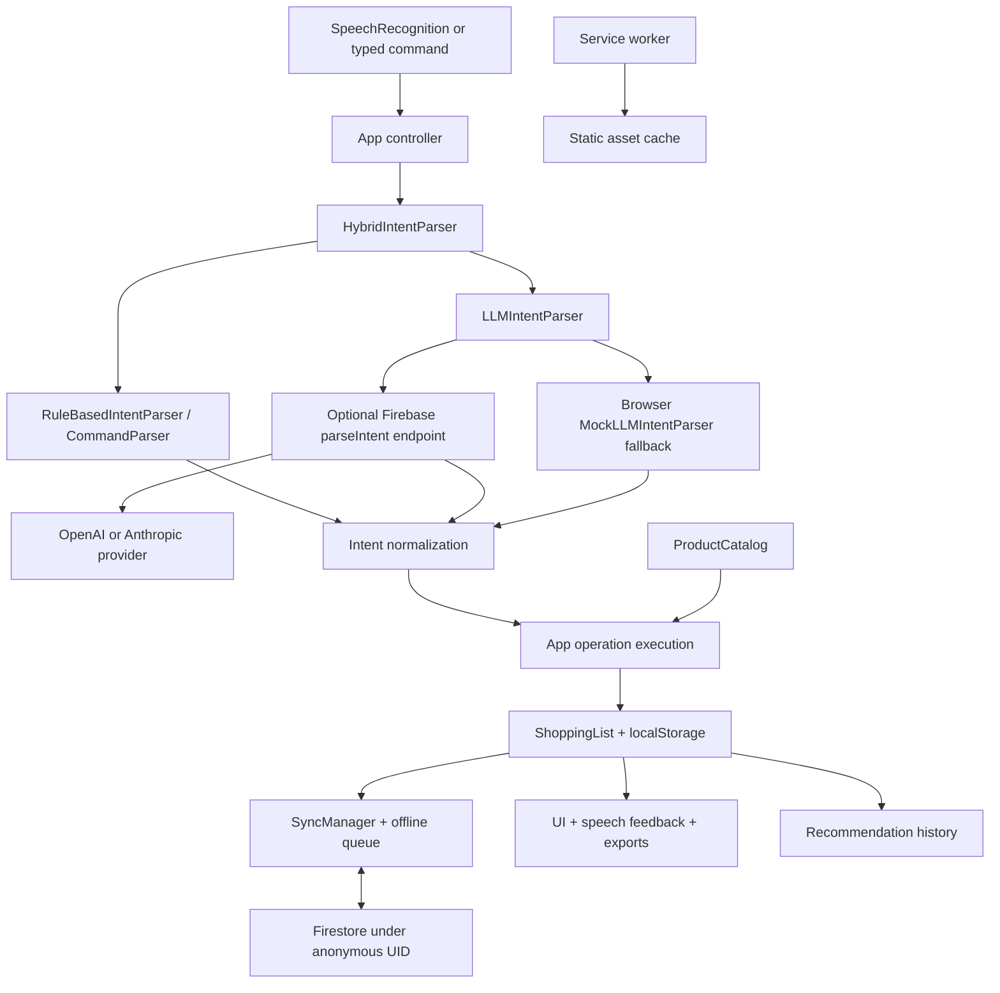

# Voice Command Shopping Assistant — improvement and agent execution plan

Prepared: **12 November 2026**. Initial investigation: 8 November; core findings and tests rechecked on 12 November.

Repository: [prathamkashyap/voice-command-shopping-assistant](https://github.com/prathamkashyap/voice-command-shopping-assistant).

## 1. Recommendation

Keep the small vanilla JavaScript application and repair its correctness boundaries before expanding its feature set. The highest-value work is reliable persistence and synchronization, safe command interpretation, a deployable browser shell, and tests that exercise those behaviors. The app already has useful product features; a framework rewrite would delay the repairs without resolving their underlying causes.

The recommended order is:

1. Establish an honest test baseline and reproducible local environment.
2. Fix hosting/CSP compatibility, unsafe DOM construction, the broken realtime listener, missing offline assets, and lost synchronization operations.
3. Define and implement explicit command, persistence, conflict, and server-validation contracts.
4. Improve keyboard accessibility, speech lifecycle, recommendations, catalog matching, exports, and user-facing status.
5. Add recoverable cross-device accounts and consider household sharing only after data correctness is demonstrated.

This document is a plan, not a claim that the fixes are implemented. Agent assignments below are proposed task fits, not results from benchmarking these agents on this repository.

Implementation checkpoint, 26 November 2026: the [sync contract and verification record](docs/sync-contract.md#implementation-status) track the durable account outbox, atomic local saves, and server replay receipts now implemented on `codex/shopping-reliability`. T06/T07 still include outstanding automatic retries, item revisions, and conflict handling. The audit evidence below retains its original review baseline.

## 2. Review baseline and evidence limits

| Item | Observed baseline |
| --- | --- |
| Local branch and commit | `main`, `92d48ed870a4426b1f55f557a52598f22d56916b` |
| Remote comparison | GitHub `main` resolved to that same commit during the 8 November read-only check; no deployment provenance was verified |
| Working tree | 18 modified tracked files and 4 untracked source/test files before this plan; these changes were included in the review |
| Untracked implementation files | `public/js/icons.js`, `test/icons.test.js`, `test/product-catalog.test.js`, `test/recommendation-engine.test.js` |
| Scope studied | Browser controllers/views, speech, all parser layers, catalog data, recommendations, local storage, sync, Functions, Firestore rules, PWA assets, manifests, package files, CI, README and approach documentation |
| Automated baseline | `npm test` passed on 8 November; `node --test --test-reporter=spec test` rechecked on 12 November: **139 reported passes, 0 failures, 0 reported skips**, Node 20.20.2 |
| Important test limitation | Eight integration cases return early when `FUNCTIONS_EMULATOR_URL` is absent, yet are reported as passes; two sync cases contain `assert.ok(true)` placeholders |
| Catalog | 38 products; unique IDs and resolvable named substitute references at review time |
| Browser scope | Source inspection, not live visual/accessibility/device certification; no production Firebase mutation or paid-provider invocation |

The analysis includes read-only Node probes with in-memory stubs for parser and sync failure paths. No full Firebase emulator suite, real microphone test, or deployed-header browser test was run. Findings marked as source-confirmed should receive executable regression cases during implementation.

Line references below refer to the reviewed working tree, including its uncommitted changes. They may differ from GitHub's committed files. In particular, the CSP incompatibility and missing listener imports **already exist at HEAD**; they are not attributed to the current uncommitted changes. The `icons.js` import/precache mismatch concerns the current working tree.

Before starting implementation, preserve and reconcile the existing work into a deliberate baseline. A new checkout of `main` alone will not contain the current improvements. Do not discard, overwrite, or blindly commit the entire dirty tree.

### Dependency audit snapshot

Read-only `npm audit --package-lock-only --json` on 8 November reported the following. These are dependency advisory counts, not proof of exploitable application vulnerabilities; refresh and assess reachability before remediation.

| Scope | Reported affected packages | Severity distribution |
| --- | ---: | --- |
| Root development toolchain | 4 | 4 high |
| Functions, all dependencies | 28 | 1 critical, 5 high, 19 moderate, 3 low |
| Functions, `--omit=dev` | 13 | 1 critical, 3 high, 9 moderate |

Examples in the Functions production report included `proxy-addr` (critical), `@grpc/grpc-js`, `body-parser`, and `node-forge` (high). Root findings included `serve` and transitive packages. Do not apply `npm audit fix --force` indiscriminately: the report proposed major changes and even older direct-package versions. T26 covers compatibility-aware remediation.

## 3. Current architecture, from input to persistence



This is the intended code flow, not evidence that every connection works. The current realtime listener fails to attach, and the service-worker background-sync stub only sends a completion message.

| Area | Main files | Existing strengths | Main improvement need |
| --- | --- | --- | --- |
| App coordination | `public/js/app.js` | Voice/text input, mixed-operation execution, category/search controls | Ordering, transaction semantics, startup isolation, truthful states |
| Parsing | `command-parser.js`, `rule-based-parser.js`, `hybrid-parser.js`, `llm-parser.js`, `intent-schema.js` | Fast local rules; explicit operations now preserved by schema normalization | One validated contract; correct deterministic clause parsing; controlled remote fallback |
| State | `public/js/shopping-list.js` | Immediate local changes, completion, undo, exports | Durable saves, operation-specific undo, validated/versioned storage |
| Cloud sync | `public/js/sync-manager.js` | User-scoped paths, merge helpers, queue scaffolding | Acknowledgment, retries, deletion history, conflict semantics, listener lifecycle |
| Backend | `functions/index.js`, `firestore.rules` | Provider adapter, structured errors, UID access isolation | Abuse controls, payload validation, deadlines, rule tests |
| UI and speech | `ui.js`, `voice-recognition.js`, `index.html`, `styles.css` | Text fallback, live regions, themes, reduced-motion styles | Safe DOM, keyboard focus, dialogs, speech state machine |
| PWA and delivery | `sw.js`, `manifest.json`, `firebase.json`, CI | Static caching, install assets, Node test runner | Complete asset graph, update policy, hosting-equivalent tests |

Preserve useful current additions: mixed operations, clear-completed controls, CSV export, queue counts, icons, improved error payloads, and catalog/recommendation tests. Several need stronger behavior checks; they do not need to be reinvented.

## 4. Evidence-backed findings

Priority definitions: **P0** blocks the next release of the affected capability; **P1** is essential correctness/security work; **P2** improves usability, maintainability, and measurement; **P3** is optional expansion. These priorities do not assert a live production incident.

| Finding | Evidence and impact | Planned tasks |
| --- | --- | --- |
| Hosting policy conflicts with page code | `firebase.json:65` disallows inline scripts/styles while `public/index.html:15–33` contains Firebase initialization and `307, 346, 377–399` contain inline handlers. Static `serve` does not reproduce hosting headers. | T02 |
| Unsafe attribute interpolation | `ui.js:189,209` interpolates item names into quoted attributes; `escapeHtml` at `517–521` escapes text markup, not quotation marks. Attribute injection is possible; script execution depends on CSP/environment. | T03 |
| Realtime listener cannot start | `sync-manager.js:426–458` references unbound `collection` and `onSnapshot`. Local probe observed `collection is not defined` and no listener attachment. | T04 |
| Failed writes disappear from the queue | `sync-manager.js:548–550` persists an empty queue before sending; `219–222` returns false on send failure and `571–584` discards that result. A queued delete disappeared when send resolved false. | T05–T07 |
| Busy writes and early deletions lack durable delivery | `sync-manager.js:168` returns false while busy; `shopping-list.js:53–59` ignores it. Deleting before sync is enabled is not recorded for later transport. | T05–T08 |
| Deleted items can reappear | Local remove at `shopping-list.js:94–103` leaves no durable tombstone; `sync-manager.js:313–315` re-adds a stale remote item absent locally. A Node probe reproduced this. | T05–T07 |
| Whole-list sends distort conflict ordering | Every save sends all items (`shopping-list.js:56`), and every item gets a fresh server timestamp (`sync-manager.js:179–202`). Unrelated edits can refresh stale records and inflate writes. | T05, T07, T29 |
| Delete may fail for a never-uploaded item | `sync-manager.js:205–211` uses `batch.update` for deletion, which requires a server record. Validate offline add/remove behavior in the emulator. | T06–T07 |
| Paid/public endpoint lacks caller controls | `functions/index.js:314–320,411–416` exposes public Functions with permissive CORS; no token verification, application quota, bounded text length, or provider-specific deadline is implemented. | T09 |
| Rules validate ownership but not record shape | `firestore.rules:6–12` restricts UID access, but permits arbitrary fields/types in an owner's records. This is not an observed cross-user access bypass. | T10 |
| Clause parser changes command meaning | `llm-parser.js:155–199` splits `candy` on `and`, mishandles numeric quantities, and creates additions for mixed remove clauses. Similar logic exists in `functions/index.js:208–250`. | T11–T14 |
| Parser routing ignores supported cases/flags | `hybrid-parser.js:58–65` misses comma-only lists; `24–25` can invoke fallback despite `fallbackToLLM:false`. | T12, T14 |
| Runtime validation is too shallow | `intent-schema.js:49–66`, `llm-parser.js:91–142`, and `functions/index.js:91–139` do not consistently enforce action enums, finite positive quantities, bounds, or filter shapes. | T11–T13 |
| Commands can run out of order or partly apply | `app.js:257–283` permits concurrent asynchronous parses; `338–374` applies operations sequentially before all can succeed, potentially leaving saved state and UI feedback inconsistent. | T13 |
| Fuzzy matching silently changes products | `product-catalog.js:12–44`: with real data, `goat milk` becomes Milk and an empty query becomes Brown Bread. No ambiguity threshold exists. | T15 |
| Pricing ignores units/packages | `shopping-list.js:230–239` and `ui.js:184–186` multiply catalog price by quantity without converting requested units or pack sizes. | T15 |
| Undo messages can name the wrong restored item | `ui.js:230–241` retains multiple toast callbacks but `shopping-list.js:94–140` holds only one last-deleted item. Apple then Bread deletion can make Apple's Undo restore Bread. | T19 |
| Dialogs and list controls need keyboard work | Hidden overlays remain focusable; dialogs lack full semantics/focus handling (`styles.css:1229–1250,1349–1366`, `ui.js:452–479`). Full row rebuilding loses focus (`ui.js:123–144`). | T16 |
| Voice lifecycle has races | `voice-recognition.js:84–100` schedules an unguarded restart and cannot reliably stop before `onstart`. There is no teardown. | T17 |
| Offline install misses an imported module | `ui.js:1` imports untracked `icons.js`; `sw.js:2–24` does not precache it. A first visit before SW control can leave the next offline launch without that module. | T18, T32 |
| PWA sync/update signals are misleading | `sw.js:142–157` posts `SYNC_COMPLETE` without a sync; install skips waiting immediately, despite the UI saying refresh to update. | T18 |
| Recommendation data is not purchase history | `app.js:407–408` records additions as purchases; corrupt JSON-shaped history breaks `.filter`, and seasonal/history results can duplicate products (`recommendation-engine.js:10–15,27–101`). | T20 |
| Language and dietary claims exceed implementation | Four recognition locales are offered, local grammar is English, remote locale is logged rather than supplied to the model; generic substitutes include Tofu → Chicken/Fish. | T21, T23, T27 |
| Cross-device account recovery is missing | `sync-manager.js:110–128` only signs in anonymously. Independent device profiles have separate identities; storage keys are not UID-scoped. | T24, T27 |
| Storage and telemetry can fail silently | List/storage shape validation is weak; save exceptions are swallowed. Telemetry clears persistence before delivery and ignores `sendBeacon(false)` (`error-tracker.js:148–161`). | T08, T25 |
| CI gives incomplete assurance | No root lint script, yet CI uses `lint --if-present`; build is an echo. Functions dependencies/rules/browser flows are not exercised. Eight integration no-ops and two placeholder tests inflate apparent coverage. | T01, T14, T26, T31 |

### Reproductions to turn into permanent regression fixtures

| Input/scenario | Current observed behavior | Required outcome |
| --- | --- | --- |
| `add candy and bread` in browser fallback | Items `c`, `y`, `bread` | Candy and Bread, with word boundaries respected |
| `add 2 apples and 3 bananas` | Quantity 1 and numeric prefixes inside names | Apples ×2 and Bananas ×3 |
| `add milk and remove bread` in fallback | Two additions, including `remove bread` | Ordered add Milk and remove Bread operations |
| `add milk, bread` | One rule-parsed item | Two validated additions |
| `find rice by India Gate` | Brand `india`, query `rice gate` | Full brand matched and Rice results |
| `do not remove milk` | Misinterpreted remove intent; downstream effect depends on matching | No destructive mutation; clarify or recognize negation |
| `fallbackToLLM:false` | Fallback still called on normal path | No remote call through any path |
| Valid response headers, delayed JSON body | Timeout is cleared before body completion | Whole response deadline respected |
| Queue send resolves `false` | Queue empties | Operation retained with visible pending/error state |
| Local delete, stale remote snapshot | Item returns | Tombstone/version policy prevents resurrection |
| Delete Apple, delete Bread, click Apple's Undo | Bread can return with Apple message | Undo targets the intended operation or old affordance is disabled |

## 5. Agent roles and assignment rationale

Use the exact requested configurations below. Do not silently substitute another model when one is unavailable. These are initial allocation hypotheses; compare actual accepted outcomes, correction effort, and time on the first few tasks.

| Short name | Requested agent/model | Proposed role | Rationale and boundary |
| --- | --- | --- | --- |
| **Devin** | **Devin Desktop — SWE 2 — Medium Reasoning** | Bounded implementation, test infrastructure, emulator integration, dependency work | Cognition describes Medium as suited to fast execution on simple/intermediate work. Give it exact contracts and end-to-end checks; route unresolved distributed-state design to Astra. [Official SWE-2 description](https://cognition.com/blog/swe-2) |
| **Flash** | **Antigravity — Gemini 3.8 Flash** | Small UI/data improvements, recommendation cleanup, mechanical modularization | Google presents Flash as a daily agentic-development workhorse with selectable thinking levels. Use short, independently verifiable patches; escalate ambiguous business semantics. [Official model announcement](https://www.antigravity.google/blog/gemini-3-8-flash-in-google-antigravity), [model selector](https://antigravity.google/docs/models) |
| **Luna** | **Codex — GPT 6 Luna** | Catalog integrity, documentation, asset checks, fixture housekeeping | Official guidance emphasizes focused/scoped work. Keep tasks bounded and give expected outputs; do not make it the sole reviewer of state-loss/security changes. |
| **Astra** | **Codex — GPT 6 Astra** | Data/command contracts, difficult tradeoffs, security and release review | Official guidance emphasizes demanding reasoning and ambiguous problems. Spend its effort on decisions and adversarial review that unlock implementation. |
| **Terra** | **Codex — GPT 6.1 Terra** | Browser interaction, accessibility, visual/keyboard QA, scoped UI fixes | Official guidance emphasizes visual reasoning, computer use, and scoped code changes. Require saved browser evidence and real keyboard checks. |
| **Sol** | **Codex — GPT 6.1 Sol** | Main implementation/integration owner for coupled app logic | Official guidance positions it for complex technical work with cost/time considerations. Use it for sync, parser, controller, and API implementation after contracts are agreed. |

The four Codex role descriptions are informed by [OpenAI's model-selection guidance](https://developers.openai.com/api/docs/guides/model-selection). The repository-specific division of work is engineering judgment, not a vendor benchmark or guarantee. Product access, tools, and selected settings must be checked in each agent's actual application. No pricing or token-speed assumptions are necessary for this plan.

For Devin, retain **Medium Reasoning** as requested and split overly broad tasks. For Flash, use its available default/medium thinking configuration initially. For Codex, start scoped tasks at low/medium, complex implementation at medium/high, and raise reasoning for unresolved invariants or adversarial review where available. Record the setting used so comparisons are meaningful.

## 6. Prioritized task register

Sizes describe change/review complexity, not promised agent runtime: **S** = narrow patch; **M** = several related modules; **L** = contract or multi-stage implementation that must be split into reviewable PRs. Every task requires its stated checks plus relevant existing regressions. Owner implements; reviewer independently checks behavior and scope.

| ID | Priority | Task | Owner | Reviewer | Size | Dependencies |
| --- | --- | --- | --- | --- | --- | --- |
| T01 | P1 / first | Reproducible baseline and honest CI | Devin | Sol | M | Baseline reconciliation |
| T02 | P0 | CSP-compatible initialization and handlers | Sol | Terra | M | T01 harness |
| T03 | P0 | Safe DOM construction | Sol | Astra | S | T01 harness |
| T04 | P0 | Realtime listener lifecycle repair | Devin | Sol | S | T01 adapter seam |
| T05 | P1 / first | Persistence and conflict design contract | Astra | Sol | M | Current failure reproductions |
| T06 | P0 for sync | Durable operation queue and acknowledgments | Sol | Astra | L | T05 |
| T07 | P1 | Item versions, tombstones, and delta writes | Sol | Astra | L | T05, T06 |
| T08 | P1 | Storage validation, recovery, and startup | Devin | Sol | M | T05 storage interface; T06 integration |
| T09 | P0 before paid endpoint exposure | API admission, budgets, and provider deadlines | Sol | Astra | M | T01; T11 for output validation |
| T10 | P1 | Firestore schema rules and emulator matrix | Devin | Astra | M | T05, T07 schema |
| T11 | P1 / first | Canonical intent and execution contract | Astra | Sol | M | Current parser fixtures |
| T12 | P1 | Correct deterministic parser and fallback policy | Sol | Astra | L | T11 |
| T13 | P1 | Ordered, validated command transactions | Sol | Astra | M | T06, T11, T12 |
| T14 | P1 | Parser corpus and transport regression suite | Devin | Astra | M | T11; expands alongside T12–T13 |
| T15 | P1 | Catalog identity, units, and estimate correctness | Sol | Astra | M | T11, T21; schema coordination with T05/T07/T08/T10 |
| T16 | P1 | Keyboard, dialogs, screen-reader interaction | Terra | Sol | M | T02, T03; T13 UI boundary |
| T17 | P2 | Speech lifecycle and progressive fallback | Terra | Sol | M | T13 command interface |
| T18 | P1 | Offline lifecycle and safe PWA updates | Devin | Terra | M | T02, T32; T06 for sync status |
| T19 | P1 | Undo and export correctness | Devin | Sol | M | T13; T03 rendering |
| T20 | P2 | Recommendation integrity | Flash | Sol | M | T13 completion events; T21 |
| T21 | P2 / early | Validate the actual catalog | Luna | Sol | S | None |
| T22 | P2 | Initial preferences and shopper-focused UI | Flash | Terra | S | T16; status contract from T06 |
| T23 | P2 | Honest locale support and language UX | Terra | Sol | M | T11, T12, T17 |
| T24 | P2; P1 if cross-device promise retained | Account linking, recovery, and isolation | Sol | Astra | L | T07, T08, T10 |
| T25 | P2 | Privacy-aware, reliable diagnostics | Devin | Astra | M | T09 endpoint admission |
| T26 | P1 | Dependency and runtime maintenance | Devin | Sol | M | T01 baseline |
| T27 | P2 / early | Accurate docs and contributor setup | Luna | Terra | S | Initial audit; finalize after T18/T24 |
| T28 | P2 | Focused modularization and CSS cleanup | Flash | Sol | M | Functional repairs in touched modules |
| T29 | P2 | Measured performance and operational signals | Sol | Astra | M | T07, T12, T18, T25 |
| T30 | P3 | Evidence-led feature expansion design | Astra | Terra | M | Reliability release and user feedback |
| T31 | P1 / release gate | Independent integrated release review | Astra | Terra + Sol | M | All tasks selected for that release |
| T32 | P1 / early | Static asset and repository completeness | Luna | Devin | S | Baseline reconciliation |

## 7. Task specifications and acceptance criteria

### T01 — Reproducible baseline and honest CI

**Evidence:** `package.json`, `functions/package.json`, `.github/workflows/ci.yml`, `test/llm-integration.test.js`, `test/sync-manager.test.js:301–314`.

Create explicit unit, provider-stub, emulator/rules, and browser-smoke commands. Preserve Node's built-in runner for pure logic. Add a minimal browser harness and pinned development tooling only where necessary. Make local/demo/emulator selection explicit so tests cannot accidentally target production Firebase or paid providers. Install Functions dependencies in the appropriate job; configure Auth, Firestore, Functions and Hosting emulators together where required. Replace nonexistent optional lint checks with a real check or remove the misleading job. Include undefined-variable detection that catches the missing listener imports.

**Done when:** a clean baseline checkout installs both lockfiles reproducibly; missing emulator prerequisites produce explicit skips or a failing dedicated integration job; placeholders are replaced; no expected suite silently passes without executing; default CI contains no provider secrets and makes no paid calls. Record exact commands, versions, counts and unexecuted suites.

### T02 — Make the app work under its configured CSP

**Evidence:** `public/index.html:15–33,307,346,377–399`, `firebase.json:65`.

Move Firebase setup to an external, awaitable module with explicit local/emulator/cloud configuration. Replace inline event handlers with registered listeners; replace inline styles that violate the policy with CSS classes or appropriate hidden-state controls. Keep local shopping usable when Firebase initialization is slow or unavailable. Preserve the restrictive CSP rather than adding broad `unsafe-inline` allowances. CSP's inline restrictions are documented in [MDN's CSP guide](https://developer.mozilla.org/en-US/docs/Web/HTTP/Guides/CSP).

**Done when:** a browser using Hosting-equivalent headers initializes the app and configured emulator auth, opens/closes overlays, copies/exports/shares with handled errors, and produces no relevant CSP violations. Also test Firebase unavailable and text-only local operation. Save console/header evidence; plain static-server success is insufficient.

### T03 — Remove unsafe HTML attribute interpolation

**Evidence:** `public/js/ui.js:175–213,517–521`.

Construct dynamic rows using DOM properties and `textContent`/`setAttribute`; reserve HTML templates for trusted static markup. Audit every dynamic HTML sink, including categories, units, product results and toast content. Treat catalog, local storage, and remote record values as untrusted at rendering boundaries.

**Done when:** quotation marks, apostrophes, ampersands, angle brackets and event-handler-shaped item names remain literal visible/accessibility text, create no extra attributes, and execute no handlers. Test DOM structure, not merely string escaping. Existing list interactions remain functional with CSP enabled.

### T04 — Restore realtime synchronization attachment

**Evidence:** `public/js/sync-manager.js:426–465`.

Bind Firestore functions through a small testable adapter, report attachment failure through the sync state, and make start/stop idempotent. Handle auth changes and teardown explicitly; do not create duplicate subscriptions on reconnect.

**Done when:** a fake transport proves exactly one listener attaches, snapshots reach the merge boundary, errors change status, and unsubscribe runs once. An emulator test with two sessions under the same test identity observes remote changes. Different real devices sharing an account remain T24, not an implied result of this repair.

### T05 — Decide persistence and conflict semantics before rewriting sync

**Deliverable:** a short architecture decision record with examples, invariant tests, migration strategy and rejected alternatives.

Define operation IDs, stable item IDs, ordering, acknowledgments, duplicate delivery, concurrent quantity changes, field edits, delete/undo precedence, timestamp ties, clock skew, tombstone retention, identity namespaces, and old-client compatibility. Compare a repaired explicit outbox with Firestore's managed offline persistence; select one authority for delivery to avoid competing queues. Firestore can manage offline writes and uses last-write-wins for same-document changes, but that does not by itself decide this app's quantity/delete semantics. [Official offline behavior](https://firebase.google.com/docs/firestore/manage-data/enable-offline).

**Recommended starting point:** a durable operation log with an explicit conflict policy and minimal schema, not an automatic CRDT migration. Evaluate IndexedDB if atomic item-plus-outbox persistence or volume requires it; document localStorage limitations if retained.

**Done when:** the design traces add/edit/delete/undo through offline restart, duplicate delivery, two writers and stale snapshots; each trace has an expected final state and a corresponding test plan. T06/T07 must implement this agreed contract.

### T06 — Durable outbox, retries and truthful sync states

**Evidence:** `sync-manager.js:144–222,503–584`, `shopping-list.js:28–59`.

Persist mutations before transport, including while Firebase is unavailable or another send is in flight. Remove only acknowledged operations. Use one serialized sender, bounded retry/backoff, idempotent operation IDs and safe compaction. Separate transient errors from permanent denial; retain recoverable user data with a clear retry/export path. Derive `local-only`, `offline`, `pending`, `syncing`, `synced` and `error` from actual state rather than `navigator.onLine` alone.

**Done when:** resolved-false sends, thrown sends, permission denial, process interruption after server commit/before local acknowledgment, repeated reconnect, reload while sending and rapid add/edit/delete all preserve the contract. No green synced state appears with unacknowledged work. Bound batch size and queue growth; never drop user operations just to satisfy a limit.

### T07 — Convergent item updates and durable deletion

**Evidence:** `sync-manager.js:179–211,268–343`, `shopping-list.js:94–103`.

Send only changed items/operations. Preserve meaningful versions rather than restamping the whole list. Retain tombstones locally and remotely according to T05, and use deletion writes that are valid when an item never reached the server. Reconciliation should not repeatedly write its own unchanged results.

**Done when:** two clients editing different items preserve both edits; same-item edits follow the documented policy; stale snapshots never resurrect a valid deletion; remove/undo/replay and clock skew are deterministic; add-then-remove before first upload is safe. Measure writes per mutation. Migration from existing records and rollback compatibility must be demonstrated with fixtures.

### T08 — Validate storage and keep recovery available

**Evidence:** `shopping-list.js:11–33`, `sync-manager.js:503–512`, `app.js:24,66–75`, `ui.js:43–50`.

Version and validate stored list, queue and preference shapes. Handle malformed JSON, valid JSON with the wrong shape, missing fields and unavailable/quota-limited storage. Quarantine recoverable data instead of silently overwriting it. Surface unsaved changes clearly and offer export/retry. Load the existing list before optional catalog/cloud enrichment. Implement migrations using the persistence interface selected by T05/T06, not a second incompatible store.

**Done when:** storage denial does not crash initialization; broken history/list/queue payloads recover predictably; an unsuccessful durable save never produces a false saved confirmation; migrations preserve valid items and pending operations, including across reload.

### T09 — Bound and protect optional backend processing

**Evidence:** `functions/index.js:67–89,142–165,314–441`; `llm-parser.js:43–65`.

Separate explicit local/demo and provider-enabled modes. Validate request content type/body, trimmed text, locale, string/array limits and response schema. Where cloud access is enabled, verify caller identity and appropriate attestation, use per-principal quotas and bounded concurrency, and add an operational spend limit/disable switch. CORS is browser policy, not authorization. Treat anonymous-account creation as an abuse consideration rather than assuming an anonymous token alone is a quota defense.

Use managed secrets and provider-specific model configuration. Propagate deadlines/cancellation through provider requests and response body parsing; the current client clears its timer before `response.json()`. Give safe structured errors without exposing secrets or raw provider internals. Do not silently switch to a newer LLM merely because it exists.

**Done when:** unauthorized, oversized, malformed, throttled and disabled-mode requests never invoke providers; slow headers and slow bodies respect the deadline; retries cannot multiply charges without bounds; client behavior under 429/503/invalid output is deterministic. Test with provider stubs; any paid validation is a separate deliberate step.

### T10 — Enforce the actual Firestore document contract

**Evidence:** `firestore.rules:6–12` and the schema selected in T05/T07.

Retain UID isolation and add allowed-field/type/bounds rules, stable document identity, valid deletion/version transitions, and compatible migration handling. Avoid client-supplied ownership overrides. Use the emulator test library rather than validating rules only by reading them. [Firebase rule-testing guidance](https://firebase.google.com/docs/rules/unit-tests).

**Done when:** unauthenticated/wrong-user requests fail; malformed own-user records fail; valid creates, edits, tombstones, undo and batches succeed. Include oversized names, negative quantities, unexpected fields and identity mismatch. Test actual `NaN`, `Infinity` and `-Infinity` values through the Firestore SDK as well as malformed JSON requests: JSON serialization alone converts those numeric values to null and misses that rules boundary. Schema changes cannot strand older valid clients without an explicit compatibility decision.

### T11 — One canonical command contract

**Evidence:** `intent-schema.js`, `functions/index.js:91–139`, `llm-parser.js:91–142`.

Specify a versioned runtime contract shared or equivalently enforced in browser and server. Define allowed actions/sources, strings and maximum lengths, finite quantity ranges, unit normalization, search filters, operation order and limits, and consistency between `items` and `operations`. Distinguish missing values from explicit zero and choose action-specific quantity semantics. Preserve explicitly supplied mixed operations already supported by current code.

Define unknown/ambiguous/unsupported outcomes that do not mutate the list. Existing confidence constants are heuristic metadata, not calibrated accuracy estimates. Fix source enum drift (`mock-llm`, `hybrid-fallback`) and nullable-field mismatches.

**Done when:** browser/server fixture suites agree; malformed provider outputs cannot reach mutation code; negative/NaN/Infinity-like runtime values, unknown actions, oversized arrays and inconsistent operations are rejected with useful errors. Compatibility and version mismatch behavior are explicit.

### T12 — Correct local clause parsing before remote fallback

**Evidence:** `command-parser.js`, `hybrid-parser.js`, `llm-parser.js:147–205`, duplicate mock parser in `functions/index.js`.

Extract one deterministic clause parser that reuses single-item quantity/unit parsing. Recognize word boundaries, comma lists and mixed verbs; handle multiword brands; define filter-only search behavior. Reject or ask about negation and unsupported sequencing rather than confidently guessing a destructive action. Preserve custom product names. Route deterministic supported commands locally before optional remote parsing, and honor disabled/fallback flags in every success/error path.

**Done when:** all section 4 command fixtures have exact expected actions, names, quantities and units; local mode makes zero provider calls; simple existing commands remain valid; browser/server demo fixtures agree. Do not select the result with more items merely because it has more items. Split grammar repair, routing, and duplication cleanup into separate reviewable changes.

### T13 — Order commands and apply them coherently

**Evidence:** `app.js:257–283,338–374`, `shopping-list.js` mutation methods.

Choose and implement submission-order execution with explicit pending/error states. Validate and plan an entire multi-operation command before applying it. Prefer a single domain transaction and outbox operation group; if partial success is a deliberate product choice, show each outcome and render the actual saved state. Make undo refer to command/operation identities. Prevent duplicated submissions or stale asynchronous results from silently applying twice. Define a stable completion-transition event with an event ID, item ID and transition state, shared by checkbox actions and any supported command-based completion; this is the interface T20 consumes.

**Done when:** reversed parse-completion timing preserves chosen order; add-then-invalid-remove behaves exactly as specified; cancellation, double-send and provider failure are tested; UI, stored list, outbox and feedback describe the same result. Invalid commands leave state unchanged under the atomic policy. Completion-transition tests prove stable identity across delivery/replay and consistent behavior through checkbox actions and supported command paths; replay does not become another purchase event.

### T14 — Evaluate parser behavior and failure paths honestly

Create a reviewed fixture corpus for simple/multi commands, numeric/word quantities, units, punctuation, ambiguity, negation, multiword brands, malformed payloads and unavailable providers. Assert full structured output rather than item counts alone. Keep a held-out set for evaluation so fixing examples does not become the whole definition of quality. Add fetch status, malformed JSON, delayed body, timeout and cancellation tests.

**Done when:** critical destructive-command fixtures have zero unintended mutations; reports show action/item/quantity exactness, clarification rate, fallback rate and latency separately. Declare sample sizes and environment; do not reuse the unsupported “90%+ commands” claim. Eight integration no-ops become explicit skips or real emulator assertions. Human/native-language review is required before claiming language accuracy.

### T15 — Make matching and estimates trustworthy

**Evidence:** `product-catalog.js:12–44`, `app.js:395–403`, `shopping-list.js:230–239`.

Return exact/alias/ambiguous/no-match results with candidate scores instead of silently choosing any loose match. Preserve qualifiers and custom item names. Separate product ID, display name, amount, unit, package size, currency and unit-price basis. Show known-price coverage and clearly label sample/estimated prices. Define handling for incompatible units rather than multiplying arbitrary quantities. Feed the proposed fields into T05 before the storage schema freezes where possible; if added later, treat them as a coordinated versioned migration with T07 persistence, T08 recovery/validators and T10 rules, not an isolated catalog patch.

**Done when:** `goat milk` stays custom or prompts for a choice; empty input never matches a product; ties do not depend on JSON order; 1 kg versus a 5 kg pack has defined math; unknown prices are visible; list display and exported totals agree. Include currency formatting and decimal rounding fixtures. Any persisted-field changes land with compatible migrations, validators and rule updates, tested against old records. This is catalog correctness, not a live retailer-price integration.

### T16 — Keyboard and accessible interaction repair

**Evidence:** `ui.js:123–144,175–241,452–479`, `app.js:213–237`, `index.html:251–264,342–403`, modal/inspector CSS.

Use semantic dialogs or equivalent focus-managed components. Closed panels must be absent from tab order; opening sets focus, Escape works from inputs, closing restores the opener. Preserve row-control focus after rerender or use keyed DOM updates. Use native list semantics, meaningful item-specific button names, visible checkbox focus, and correct filter-button state rather than incomplete tab semantics.

**Done when:** all core list and dialog flows work by keyboard at mobile/desktop sizes and zoom; screen-reader announcements explain changed quantity/completion/filter results; no focus is hidden under `aria-hidden`; high contrast and reduced motion remain usable. Closed inspector/export/architecture controls are unreachable by Tab immediately after initial load, before any panel has been opened. Automated checks supplement manual keyboard/screen-reader evidence; screenshots alone are insufficient.

### T17 — Speech state machine and text fallback

**Evidence:** `voice-recognition.js:14–107`.

Model idle, starting, listening, stopping, processing and error states. Cancel retry timers and ignore late callbacks after stop/teardown. Coordinate speech output so it does not unintentionally reenter input. Keep text entry available when speech is absent, denied or disconnected. Explain that offline list editing and offline speech recognition are distinct capabilities: some browsers use server-based recognition. [MDN SpeechRecognition documentation](https://developer.mozilla.org/en-US/docs/Web/API/SpeechRecognition).

**Done when:** stub tests cover unsupported APIs, denied permissions, no-speech/network errors, repeated start, stop-before-start, late results and teardown; no duplicate commands occur. Run a separate physical-device/browser microphone matrix and record results rather than assuming every offered locale/browser works.

### T18 — Reliable offline install and update lifecycle

**Evidence:** `sw.js`, `manifest.json:66`, `app.js:109–125`.

Use the asset completeness check from T32. Choose a coherent SW update policy that keeps an open app's modules/data compatible and preserves pending writes. Namespace cache cleanup; avoid deleting unrelated origin caches. Make update prompts correspond to actual activation behavior. Remove false background-sync completion messages or replace them with acknowledged work using the chosen persistence design; localStorage cannot simply be read from a worker.

**Done when:** a fresh first online visit followed directly by offline reload works without an intervening controlled online reload; old open tab + new version + offline restart remains coherent; failed precache does not destroy the working version; pending mutations survive update. The install shortcut focuses add input as advertised, including offline query-string navigation. Test HTTPS/localhost install behavior and record device limits.

### T19 — Correct undo and reliable exports

**Evidence:** `ui.js:230–241`, `shopping-list.js:94–140,244–258`, inline export handlers in `index.html`.

Bind undo to an operation token or invalidate superseded buttons. Consolidate text/Markdown/CSV/share into a controller that awaits success, handles denied clipboard access and treats share cancellation quietly. Retain selectable/downloadable fallback output. Define spreadsheet-safe CSV text handling for formula-leading names; quoting CSV alone does not prevent spreadsheet formulas.

**Done when:** two fast deletions and both undo click orders restore the correct item or clearly report expiry; repeat undo is harmless; remote changes do not restore stale values unexpectedly. Exports handle quotes, line breaks, Unicode, formula-leading text and permission errors; no success toast appears before completion.

### T20 — Recommendations grounded in actual events

**Evidence:** `recommendation-engine.js`, `app.js:407–408,460–464`.

Record a defined completion/purchase event rather than every addition; prevent repeated completion toggles from inflating history. Validate loaded history, apply retention consistently in memory/storage, inject a clock, deduplicate product IDs across suggestion reasons, and require evidence before wording such as “often.” Make seasonal suggestions explicitly regional or generic. Preserve user control to dismiss/reset recommendations.

**Done when:** abandoned adds do not count as purchases; one event does not claim frequency; `{}`/invalid history recovers; memory and persisted history obey the same bound; suggestions contain no duplicate product; time-based tests do not depend on today's month. Flash owns the bounded recommendation module after Sol exposes stable domain events.

### T21 — Validate real catalog data

**Evidence:** `public/data/products.json`, `test/product-catalog.test.js` currently using synthetic data.

Add checks against the actual catalog for IDs, names, aliases, categories, finite nonnegative prices, units and substitute references. Introduce currency/package fields only through the T15 schema decision. Separate generic alternatives from dietary/allergen suitability; do not describe Tofu → Chicken/Fish as dietary-safe substitution. Keep raw data edits small and auditable.

**Done when:** all current 38 entries pass the defined present-day schema; intentional invalid fixtures fail with actionable locations; no unsupported dietary/real-time-price claim remains. The validator scales with dataset changes rather than hardcoding 38 as a permanent maximum.

### T22 — Accurate preferences and a clearer shopping UI

**Evidence:** `app.js:24,151`, `index.html:70,102–104,298–370`, `ui.js:432–436`.

Initialize TTS/theme/status controls from actual state. Preserve confidence zero with nullish handling; label heuristic scores and unavailable timing honestly. Put optional architecture/AST diagnostics behind a developer view so routine shoppers see input, list, recovery and sync state first. Improve empty/loading/error states and responsive spacing using existing design tokens.

**Done when:** muted preference survives reload both behaviorally and visually; disconnected users never see an initial false synced state; all supported states have readable copy; layouts work with long names and small viewports. Flash handles scoped presentation work, with Terra reviewing interaction and visual evidence.

### T23 — Define locale support end to end

**Evidence:** four recognition locales in `index.html:109–113`; English local grammar; `functions/index.js:330–359` logs but does not pass locale into provider instructions.

Publish a capability matrix for recognition, deterministic parsing, remote parsing, currency/units and spoken feedback. First make the existing English workflow reliable. Add each further language behind a tested capability flag, with locale-aware normalization and native-speaker review. Speech-to-text language availability is not proof of command-parser language support.

**Done when:** every offered language either completes the documented workflow with reviewed fixtures or is clearly limited; unsupported commands do not mutate state; feedback language is consistent; offline limitations are visible. Flash can produce fixture candidates, but expected meanings need human review.

### T24 — Recoverable cross-device identity

**Evidence:** anonymous-only sign-in in `sync-manager.js:110–128`; global local storage keys.

Keep frictionless guest use and add an optional reusable sign-in/linking path if cross-device continuity is a product goal. Preserve guest data during linking; specify merge behavior for existing accounts, credential conflicts, sign-out and account switching. Namespace all list/history/outbox data by identity; never flush one user's pending operations under another UID. Firebase supports linking credentials to an anonymous account while retaining access to its data. [Official account-linking example](https://firebase.google.com/docs/auth/web/anonymous-auth).

**Done when:** independently provisioned browser profiles signing into one test account converge; separate accounts remain isolated; guest upgrade preserves data; account-switch/reload/offline cases cannot leak or lose pending work. If deferred, correct the cross-device claim in T27 immediately.

### T25 — Minimal, reliable diagnostics

**Evidence:** `error-tracker.js:18–81,125–198`, `functions/index.js:411–441`.

Define allowed fields, consent/disable behavior, redaction, byte/count/age retention, server admission and deletion/reset behavior. Avoid raw transcripts, shopping contents, URL query strings and sensitive error context by default. Preserve queued reports through failed transport, honor `sendBeacon` acceptance and content type, and remove listeners/timers on teardown. Maintain the current improvement that logs command length rather than raw command text.

**Done when:** disabled mode sends nothing; rejected beacon/fetch and reload during send do not silently lose accepted diagnostics; queue limits are enforced; malformed queues recover; sensitive test strings are absent from outbound payloads. Server limits prevent arbitrary log spam, and logs distinguish operational categories without unnecessary personal data.

### T26 — Compatibility-aware dependency/runtime maintenance

Refresh both lockfile audits, separate development and production reachability, and inspect affected paths. Update the minimum coherent package set and verify provider SDK compatibility with the adapter. Recheck supported Node/Firebase runtime schedules when implementing; align README, root tooling, CI, Functions engines and `firebase.json` rather than assuming Node 18+ remains a useful setup instruction. Firebase runtime selection has its own supported versions and configuration precedence. [Official runtime guidance](https://firebase.google.com/docs/functions/manage-functions).

**Done when:** clean installs and meaningful unit/emulator/browser checks pass; production high/critical advisories are remediated or have specific reachability evidence, owner and expiration for any exception; lockfile changes are explained. Add scheduled dependency-update proposals and secret/dependency checks if maintainable. Do not turn an advisory count into an unsupported claim of exploitation.

### T27 — Documentation that matches the product

Update README/APPROACH with local-only, emulator and provider-backed setup; actual Node/tool prerequisites; optional secret configuration; test commands and skip meanings; account/offline limitations; browser support; catalog price assumptions; privacy behavior and rollback instructions. Replace fixed test counts and unmeasured sub-millisecond/90%+/zero-cost guarantees with evidence or bounded descriptions. Explain that anonymous UID isolation is not a reusable cross-device login. Cloud/provider configuration and free static operation are different modes.

Add an actual license file consistent with the project's declared MIT intent, after confirming copyright/third-party scope; package metadata alone is not a license text. Add concise contribution/security-reporting guidance and safe environment examples. Track useful source/test additions deliberately and exclude generated `.firebase` cache artifacts through a reviewed hygiene change, preserving local deployment metadata as needed.

**Done when:** a new contributor follows the instructions without hidden global dependencies or production access; every feature statement corresponds to implemented/tested behavior. Luna drafts from verified facts; Terra checks user-facing clarity.

### T28 — Small, behavior-preserving structural cleanup

After correctness work, separate app orchestration, domain mutations, storage/transport adapters and rendering enough to test each boundary. Consolidate duplicate parser logic through T12 and duplicate icon sources after T32. Reduce repeated CSS override sections and remove genuinely unused constants/branches. Add JSDoc/checking or a limited type-checking path if it protects the agreed contracts; a full TypeScript/framework conversion is not a prerequisite.

**Done when:** changes are small and behavior-preserving, existing regression checks pass, focused UI snapshots remain equivalent where expected, and module responsibilities are documented. Avoid combining mechanical cleanup with a new sync/intent schema in one PR.

### T29 — Measure performance and operational behavior

Capture startup-to-editable-list time, local parse latency, remote fallback latency/rate, retries, oldest pending operation, acknowledged sync delay, Firestore reads/writes per mutation and dependency/asset sizes. Keep diagnostics aggregate and privacy-aware. Profile before optimizing; current small catalog does not justify a search service or vector database.

**Proposed targets, not measured achievements:** local mutation-to-render p95 under 100 ms on a declared reference device with 200 items; no avoidable main-thread long tasks during ordinary edits; zero lost operations in the deterministic failure suite; zero unnecessary provider calls for the supported local fixture set. Set online sync latency/error budgets after measuring emulator and staging behavior separately.

**Done when:** a repeatable benchmark records device/browser/network, sample size and raw measurements; budgets have owners; regressions trigger useful checks without brittle timing assertions in unit tests.

### T30 — Feature expansion after reliability

Use short user trials to rank multiple named lists, reusable templates, pantry/replenishment reminders, household sharing, barcode input and receipt/recipe import. Default next candidate: multiple named lists/templates because they can build on stable local semantics without a new paid service. Household sharing requires membership/roles, revocation and conflict policy, not just changing a Firestore path. Camera/OCR and URL imports require permissions, source trust, preview/correction, and cost/latency evaluation.

**Done when:** each proposed feature has a user problem, smallest prototype, data/security impact, success measure and stop criterion. Create implementation tasks only for a selected feature. Do not add payments, retailer integrations, vector search or a large agent framework without evidence that users need them.

### T31 — Independent release review

Review the integrated candidate, not just individual PR reports. Re-run selected unit, stub, emulator/rules and browser suites; inspect changed data migrations and deployment headers; exercise offline restart, pending-write update and recovery flows. Terra supplies keyboard/mobile/browser evidence; Sol supplies integration/repro steps; Astra challenges security and data-loss invariants.

**Done when:** no unresolved P0 remains in the release's enabled capabilities; required checks executed with honest skips; migration/rollback is documented; unresolved P1s have explicit disposition. Produce a release note with exact commit, feature-mode configuration, test evidence and limitations. Deployment remains a separate action requiring the user's instruction; this planning task does not deploy anything.

### T32 — Asset and repository completeness checks

Check local ES-module imports, manifest icon paths, static references and the service-worker precache against files actually included in the release. Include `icons.js` and its test deliberately after reviewing existing work. Detect missing modules using a clean checkout/package, not only the developer's directory. Avoid blanket adds of generated files.

**Done when:** a missing import or precache-required dependency makes the check fail; valid assets pass; manifest shortcut handling is tracked in T18; the clean release package contains everything the page loads. Luna owns deterministic checks; Devin integrates them into PWA/CI work.

## 8. Separate queues for the six requested configurations

### Devin Desktop — SWE 2 — Medium Reasoning

**Primary queue:** T01 → T04 → T26; then T08/T10 after data contracts, T14 after command contract, T18 after assets/CSP, T19 after command transactions, and T25 after endpoint protection.

Best briefs contain a bounded file list, expected failure, acceptance matrix and one test command. Give Devin ownership of transport-test scaffolding, emulator wiring and reproducible failure cases. Split T08/T10/T18 into one subsystem per PR. Escalate disputed merge semantics, identity migration, or ambiguous destructive commands to Astra/Sol instead of expanding a Medium-reasoning implementation task indefinitely.

### Antigravity — Gemini 3.8 Flash

**Primary queue:** T20 recommendation integrity → T22 UI state/polish → T28 scoped cleanup. **Supporting work:** candidate locale fixtures for T23 and catalog normalization proposals for T21, in separate files and after the schema is fixed.

Provide before/after examples, expected UI states and narrow edit boundaries. Require full assertions for data transformations and browser screenshots for visual edits. Flash should not independently redesign quantities, sync conflict resolution, permissions or server authentication while implementing presentation/data cleanup.

### Codex — GPT 6 Luna

**Primary queue:** T21 real-catalog validation → T32 asset completeness → T27 documentation and repository hygiene.

Use compact tasks such as validating actual JSON, finding dead asset references, making setup docs reproducible, and updating capability tables from accepted evidence. Require a report of exactly what was checked and unresolved facts. Additional fixture maintenance is appropriate once Astra/Sol have approved the expected meanings; generating plausible assertions is not a substitute for those meanings.

### Codex — GPT 6 Astra

**Primary queue:** T05 sync/persistence contract → T11 intent contract → T31 independent release review; T30 expansion design only after a stable release.

**Review queue:** T03, T06, T07, T09, T10, T12–T15, T24, T25 and T29. Focus on failure models, data migration, ambiguity and abuse boundaries. Request counterexamples and executable invariants. Avoid spending every task on line-by-line cosmetic review; use Astra where an incorrect decision would contaminate several later changes.

### Codex — GPT 6.1 Terra

**Primary queue:** T16 accessible interaction → T17 speech lifecycle → T23 locale UX/capability matrix. **Review queue:** T02, T18, T22, T27 and the browser portion of T31.

Use browser sessions with explicit target viewport, keyboard sequence, expected focus/state and saved evidence. Terra can own scoped implementation within speech/UI modules after command interfaces stabilize. Real microphone/screen-reader claims require the relevant tools/devices and actual checks; code inspection or screenshot similarity cannot establish them.

### Codex — GPT 6.1 Sol

**Primary queue:** T02/T03 shell/rendering safety → T06/T07 synchronization → T09 backend boundaries → T12/T13 parser/controller → T15 catalog semantics → T24 identity → T29 measurement.

Sol is the integration owner and default reviewer for bounded implementation by other agents. Split its queue into independent releases rather than one giant branch. It implements contracts approved by Astra and reconciles interfaces; it should not concurrently rewrite `app.js`, `shopping-list.js` and `sync-manager.js` while other agents edit those same files.

## 9. Execution waves and parallel-work rules

### Wave 0 — Preserve work and establish evidence

Reconcile the current dirty baseline into a reviewable branch/snapshot before handing work to other tools. Preserve the four untracked source/test files and avoid bundling generated `.firebase` cache content accidentally. Record the baseline commit plus selected local changes.

Run Devin T01, Astra T05/T11 design, and Luna T21/T32 checks in parallel on separate areas. Terra may prepare a read-only browser acceptance script. Flash can prepare a recommendation fixture proposal without modifying shared modules. End this wave with executable reproductions and agreed interface contracts.

### Wave 1 — Release blockers and core data safety

Sol owns T02/T03 first; Devin owns T04 after the adapter seam is agreed. Luna's T32 feeds Devin's T18. Sol then implements T06/T07 using T05; T09 can be a separate backend branch once server contract T11 is ready. Land narrowly scoped PRs serially where they touch the same files. T26 dependency updates run independently only if package/harness ownership is coordinated.

**Exit gate:** CSP/header smoke test, literal-text DOM regression, working listener, complete offline shell, durable pending operations, no stale-delete resurrection, and protected/disabled paid endpoints as appropriate to release mode.

### Wave 2 — Parsing, persistence recovery and confidence in tests

Sol owns T12/T13/T15; Devin expands T14 and implements T08/T10 after the schemas stabilize. Astra reviews expected meanings and data migration. No locale or recommendation feature should depend on unstable event/intent interfaces.

**Exit gate:** reviewed parser corpus, validated mutation boundary, deterministic command ordering, storage recovery, rule-denial matrix, and emulator convergence all pass.

### Wave 3 — Everyday usability

Terra owns T16/T17, Flash T20/T22, Devin T19/T25, and Luna T27 finalization. Coordinate sequential integration of shared `app.js`/`ui.js` edits: prefer module-local implementations plus a small integration patch from Sol. T23 follows stable speech/parser behavior. T28 runs last in each touched area so refactoring does not obscure correctness fixes.

**Exit gate:** keyboard/screen-reader evidence, supported speech-device results, truthful sync/preference states, safe exports/undo, predictable recommendations and accurate docs.

### Wave 4 — Cross-device capability and release

If cross-device access is selected, complete T24 with account-switch isolation tests before advertising it. Run T29 measurements and T31 integrated review. Begin T30 only after this release is stable and real user feedback exists.

### Shared-file ownership

| Shared area | Coordination owner | Rule |
| --- | --- | --- |
| `app.js`, `shopping-list.js`, `sync-manager.js` | Sol | One active writer per file; other agents submit interface/test proposals first |
| Intent contract and shared parser fixtures | Astra for meaning, Sol for implementation | Lock expected behavior before parallel fixtures/adapters |
| `ui.js`, `index.html`, `styles.css` | Terra after shell fixes | Finish Sol's CSP/DOM changes before broad UI work; Flash follows agreed tokens/components |
| `functions/index.js`, Firestore schema | Sol, with Astra review | Coordinate API/rules/schema migrations; no independent incompatible changes |
| CI/package/lockfiles | Devin | Serialize tooling/dependency updates; require clean install verification |
| Catalog/docs/static checks | Luna | Small isolated changes; data schema owned jointly with T15 |

Use isolated branches/worktrees per task. A worktree from HEAD will omit uncommitted baseline improvements, so reconcile first. Do not run all six agents against one shared checkout. Branch names can follow `codex/t06-durable-outbox` for Codex work and equivalent task IDs in other tools. PR descriptions should lead with the trigger, corrected behavior and verification, including untested limits.

## 10. Verification and release scorecard

| Layer | Required evidence | Why it matters |
| --- | --- | --- |
| Pure domain tests | Exact intents, valid quantities, list mutations, undo, matching, recommendation history | Fast deterministic correctness |
| Transport fakes | Listener lifecycle, acknowledgments, failed sends, late bodies, retries, operation replay | Failures the current suite misses |
| Emulator tests | Auth isolation, rule enforcement, two-client convergence, missing-document deletion, API stubs | Real SDK/rule interaction without production data |
| Browser tests with hosting policy | CSP, UI interactions, focus, clipboard errors, responsive states | Static server and Node tests cannot cover these |
| PWA lifecycle | First install/offline reload, version update with pending writes, old/new tabs | Offline promises depend on lifecycle, not only asset lists |
| Human/device checks | Real speech, native-language interpretation, keyboard and screen reader | Browser API mocks are not device/usability evidence |
| Release review | Exact candidate commit/configuration, migrations, rollback, dependency reachability | Makes the deployment decision reviewable |

Proposed release criteria:

- No unintended mutation in the reviewed destructive/ambiguous-command corpus.
- No lost operation or resurrected valid deletion in the documented sync failure matrix.
- No false successful save/sync/export message in tested failure paths.
- No cross-user read/write or local queue leakage in emulator/account-switch tests.
- No relevant CSP violations or missing required offline assets in the browser release matrix.
- Every advertised core workflow usable by keyboard, with device/screen-reader limitations documented.
- All selected tasks have independent review; skipped checks are visible and explained.

These are acceptance targets. The audit did not establish that the project currently meets them. Test percentages alone should not override failed invariants.

## 11. Reusable task handoff

Copy this brief into the chosen agent and fill in the task-specific values:

```text
Repository: voice-command-shopping-assistant
Baseline: <reviewed commit plus any explicitly included local changes>
Task: <Txx and title from PROJECT_IMPROVEMENT_PLAN.md>
Owner configuration: <exact agent/model/reasoning selection>
Allowed files: <narrow list; identify shared-file coordinator>
Required contracts/dependencies: <accepted task IDs and design records>

Implement only this task's behavior. Preserve unrelated existing work.
First reproduce the named failure and state the expected outcome.
Use the agreed data/intent contract; escalate ambiguity with a concrete example.
Run the acceptance checks and relevant existing regressions.
Use local/provider-stub/emulator modes; do not deploy, invoke paid providers,
modify production data, or publish external messages as part of this task.

Return:
1. Trigger and resulting behavior.
2. Files changed and why.
3. Exact checks run, results, and explicit skips.
4. Migration/compatibility/rollback impact, if any.
5. Open questions requiring reviewer decisions.
6. Small reviewable diff/PR, without automatic merge or deployment.
```

Calibrate assignments using one small task from each queue. Record acceptance-test success, review corrections, regression rate, elapsed time and actual usage if available. Reassign based on evidence; do not give different agents ambiguous versions of the same task and compare their output volume.

## 12. Community experience and source notes

Two directly inspected first-person DEV reports provided useful implementation context; this is a small evidence set, not a community consensus. Their comment threads were unavailable through the tool at review time, so no commenter agreement is claimed. Repository findings and official platform behavior remain the authority for this plan.

- 🧵 [Offline-first sync: when two edits collide, who wins?](https://dev.to/saqrelfirgany/offline-first-sync-when-two-edits-collide-who-wins-10lf) by [@saqrelfirgany](https://dev.to/saqrelfirgany) describes the explicit tradeoffs between last-write-wins, field merges and user decisions; it supports making T05's conflict policy a deliberate product choice. [Read Full Discussion on DEV](https://dev.to/saqrelfirgany/offline-first-sync-when-two-edits-collide-who-wins-10lf).
- ⚙️ [Service workers that don’t surprise you: deterministic caching for offline-first PWAs](https://dev.to/crisiscoresystems/service-workers-that-dont-surprise-you-deterministic-caching-for-offline-first-pwas-5480) by [@crisiscoresystems](https://dev.to/crisiscoresystems) documents explicit caching boundaries and observable worker readiness; these inform T18's lifecycle tests without requiring that project's exact caching policy. [Read Full Discussion on DEV](https://dev.to/crisiscoresystems/service-workers-that-dont-surprise-you-deterministic-caching-for-offline-first-pwas-5480).

Model-role sources and Firebase/Web API references are linked beside the claims they support. Model guidance was inspected during the initial November investigation; it informs allocation, not a comparative benchmark. Dependency advisory counts are dated snapshots and must be refreshed before upgrades. No active-event participation or publishing action is part of this plan.

## 13. Recommended first assignments

Start with **Devin T01**, **Astra T05/T11**, and **Luna T21/T32** in isolated scopes. Give **Sol T02/T03** once the smoke-test harness is available. Give **Terra the read-only browser acceptance pass**, then T16 after shell repairs. Give **Flash T20** after the completion-event interface is stable, with its fixtures prepared earlier if useful.

The first milestone is a shopping assistant that preserves user intent and data across errors, reloads and reconnects. Subsequent work should build on that verified behavior.
